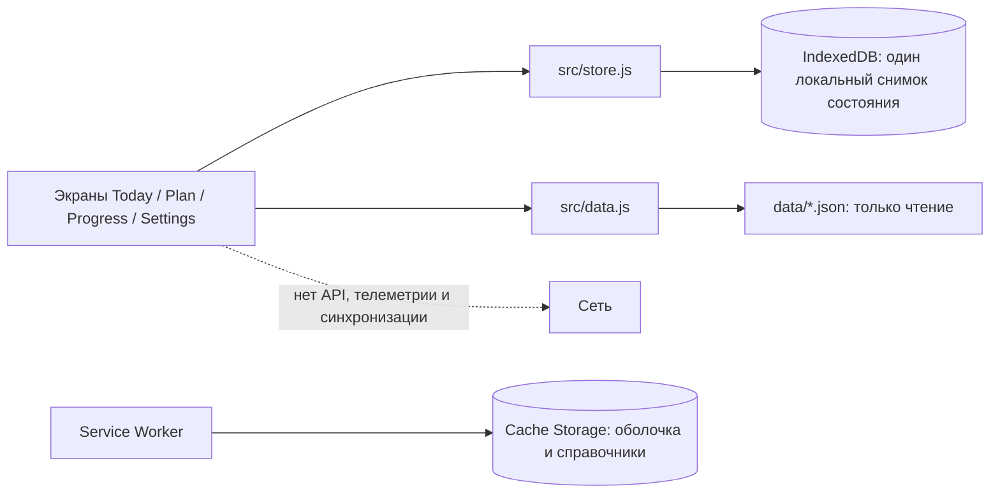

# Архитектура Vitamin CHE PWA (личный тест)

## Граница версии

Одна пользовательница, один браузер, одно устройство. Нет backend, аккаунта, серверной базы, синхронизации и аналитики. Макеты продукта и экранные спецификации задают опыт; все виды пользовательских записей в этой PWA сохраняются локально, включая структуру стека, расписание, отметки и остатки. Поэтому экран данных PWA не повторяет обещания серверной v1.0: он описывает именно локальный тестовый режим.

## Потоки

`src/store.js` — единственная точка чтения и записи личных данных. `src/data.js` загружает статические JSON из той же публикации; в запрос не добавляются данные пользователя. Внешние ссылки на PubMed открываются только после нажатия на источник.

## Данные

- `items`: банка/пункт рутины, план, расписание, остаток, заметки.
- `intakes`: отметки приёма/пропуска и действия отмены.
- `entries`, `goals`, `checkins`: локальные личные записи и отметки самочувствия/рутины.
- `language`, `reminders`: локальные настройки.
- `data/`: опубликованные справочные JSON для каталога, маркеров и источников сочетаний.

Выгрузка — читаемый JSON-файл без обратной загрузки. При заполнении квоты интерфейс показывает ошибку, запись не очищается автоматически. `navigator.storage.persist()` запрашивается при сохранении. «Очистить данные» — только отдельное подтверждаемое действие; при нём очищается только хранилище этой PWA в текущем браузере.

## Ограничения

- Системные напоминания в фоне не гарантируются. Браузерное разрешение само по себе не заменяет платформенное расписание push/local notifications.
- Оплата, Premium на сервере, sign-in и синхронизация показываются как недоступные заглушки; деньги не списываются.
- PWA — персональный прототип. Она не заявляет соответствие мобильному ТЗ, релизу, медицинской валидации или защищённому серверному хранению.
